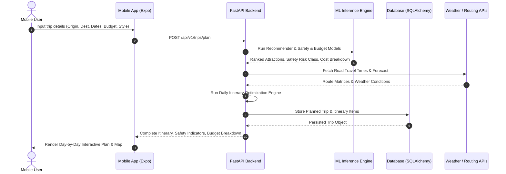

# SmartVoyage AI — Architecture Blueprint

## 1. System Overview

**SmartVoyage AI** is an intelligent, mobile-first travel planning and safety recommendation platform. It combines a cross-platform mobile client (React Native + Expo), a high-performance RESTful backend (FastAPI), a normalized database layer (PostgreSQL / SQLite development fallback), and a machine learning suite for personalized attraction recommendations, evidence-based destination safety assessments, and realistic multi-category budget estimation.

```mermaid
graph TD
    Client[React Native / Expo Mobile App] -->|HTTPS REST / JSON| Gateway[FastAPI Backend /api/v1]
    
    subgraph Backend Core
        Gateway --> Auth[Auth & Security Module (JWT, Bcrypt)]
        Gateway --> TripMgr[Trip & Itinerary Engine]
        Gateway --> RecomService[Recommendation Service]
        Gateway --> SafetyService[Safety Assessment Service]
        Gateway --> BudgetService[Budget Estimation Service]
    end

    subgraph Machine Learning Suite
        RecomService --> RecModel[TF-IDF & Content Ranker]
        SafetyService --> SafetyModel[Calibrated Risk Classifier & Fallback]
        BudgetService --> CostModel[Regression & Multi-tier Estimator]
    end

    subgraph Data & Persistence
        TripMgr --> DB[(PostgreSQL / SQLite DB)]
        SafetyService --> DB
        RecomService --> DB
    end

    subgraph External Providers
        TripMgr --> Routing[OSRM / Distance Routing API]
        TripMgr --> Weather[Open-Meteo Weather API]
    end
```

---

## 2. Component Architecture

### A. Mobile Application (`mobile/`)
- **Runtime**: React Native with Expo (SDK 52/53 compatible) & TypeScript.
- **Routing**: File-based routing via `expo-router` with Tab and Stack navigations.
- **State Management**:
  - `zustand` for persistent client states (auth tokens, user preferences, offline trip drafts).
  - `@tanstack/react-query` for network cache, deduplication, retry, and optimistic updates.
- **Form Management**: `react-hook-form` with `zod` schema validation.
- **UI & Design Tokens**: React Native Paper with modern travel theme (vibrant emerald `#008080`, deep slate `#1A202C`, sunset orange `#FF6B6B`, golden amber `#F39C12`).
- **Storage**:
  - `expo-secure-store` for sensitive authentication tokens.
  - `@react-native-async-storage/async-storage` for offline itinerary caching and trip drafts.

### B. Backend API (`backend/`)
- **Framework**: Python 3.10+ with FastAPI.
- **ORM & Data Layer**: SQLAlchemy 2.0 with declarative models; Alembic for database version control and migrations.
- **Validation**: Pydantic v2 schemas for all inputs and response models.
- **Security**: JWT bearer tokens (HS256), salted Bcrypt password hashing, CORS middleware, strict request validation, and SQL injection prevention.
- **Design Pattern**: Layered clean architecture:
  - `api/v1/endpoints/`: Route handlers and HTTP status codes.
  - `schemas/`: Request and response DTOs.
  - `services/`: Business logic, ML model wrappers, routing, scheduling algorithms.
  - `models/`: SQLAlchemy ORM database entities.
  - `integrations/`: Resilient clients with retries and offline fallbacks for external APIs (OSRM, Open-Meteo).

### C. Machine Learning Services (`ml/`)
1. **Destination & Attraction Recommendation Model**:
   - Hybrid content-based filtering using TF-IDF vectorization on attraction categories, historical interest tags, accessibility features, and user travel styles.
   - Dynamic multi-objective re-ranking based on budget match, geographical proximity, visit duration feasibility, and rating weight.
2. **Safety Risk Estimation Model**:
   - Evidence-based classification using historical incident metrics, environmental hazard indicators, and infrastructure indices.
   - Distinct separation of historical model estimations from live official travel advisories.
   - Strict "Insufficient Data" protocol: never predicting low risk when data is missing or stale.
3. **Trip Cost Estimation Model**:
   - Multi-component regression (intercity transport, local transit, lodging, food, activities, emergency contingency) with low-to-high uncertainty intervals.

---

## 3. Data Flow Diagram



---

## 4. Error Handling and Resilience Strategy
- **Degraded Network / Offline Mode**: Mobile app reads and caches current trip state locally using AsyncStorage; UI indicates stale status clearly.
- **Third-Party API Outages**: Open-Meteo and OSRM failures fall back seamlessly to geographical Haversine distance heuristics and regional seasonal weather averages without throwing 500 errors to the user.
- **Data Provenance**: Every recommendation, safety advisory, and cost estimate contains a `source` tag and `last_updated` timestamp.
