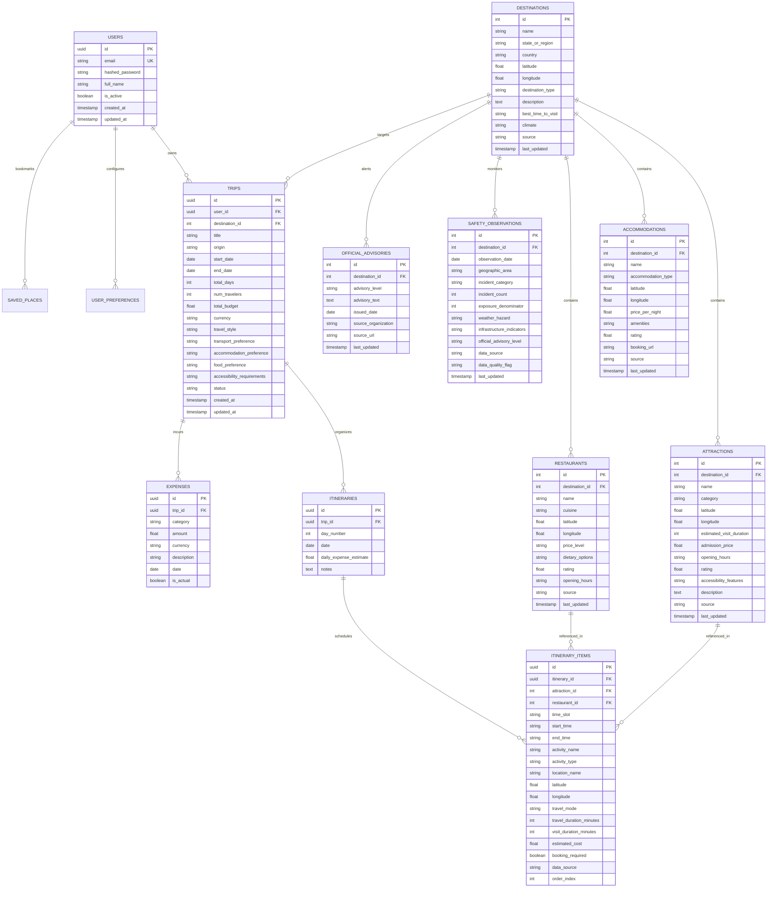

# SmartVoyage AI — Database Design & Entity Relationship

## 1. Relational Schema Architecture

The database follows a normalized relational structure designed for transactional consistency, rich spatial and metadata queries, and high read throughput for travel recommendations and itineraries.

